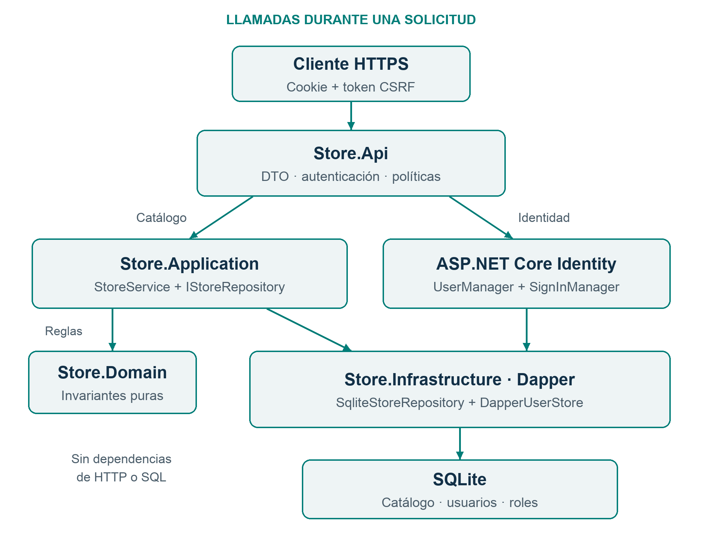
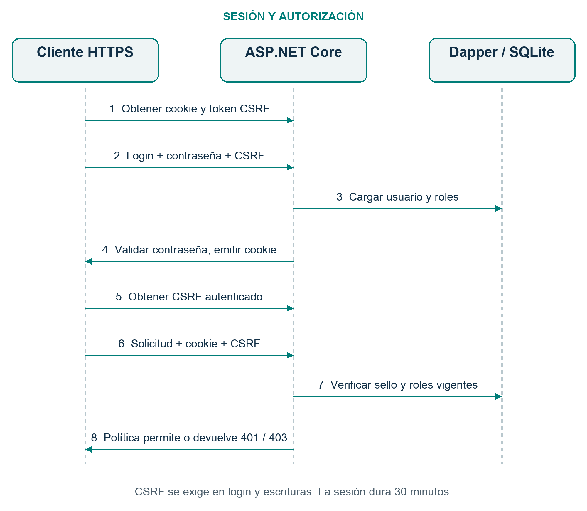

# Desarrollo de aplicaciones con .NET 10

## Arquitectura, identidad y datos

Dapper + SQLite + ASP.NET Core Identity + xUnit.net

**Versión 3.0 · 6 de noviembre de 2026**

Un manual práctico para construir una API mantenible, autenticar usuarios, aplicar permisos y comprobar su comportamiento mediante pruebas automatizadas.

El proyecto de estudio es un catálogo de categorías y productos. Incluye una base de datos local, cuentas de usuario, roles de lectura y escritura, sesiones seguras y una configuración reproducible.

**Código completo y ejecución**

[github.com/eliaquin/dotnet-development-guide](https://github.com/eliaquin/dotnet-development-guide)

**Plataforma comprobada**

.NET 10 LTS · SDK 10.0.403 · Runtime 10.0.14

Los diagramas muestran las responsabilidades de cada capa y el recorrido de una solicitud autenticada. Los comandos permiten ejecutar el proyecto y verificar sus resultados desde una terminal.

<!-- pagebreak -->

# 01 / Principios de diseño

## Responsabilidades claras

Una aplicación es más fácil de mantener cuando cada parte tiene una tarea reconocible y las dependencias son explícitas. La solución organiza el código en dominio, aplicación, infraestructura y presentación.

- **Dominio:** representa datos y reglas del catálogo sin conocer HTTP ni SQL.
- **Aplicación:** coordina casos de uso mediante contratos de persistencia.
- **Infraestructura:** implementa Dapper, SQLite, el almacén de identidad y las transacciones.
- **API:** define los contratos HTTP, la autenticación, los permisos y la composición de servicios.
- **Pruebas:** comprueban reglas aisladas y escenarios completos con la base real.

Cada dependencia se recibe por constructor. Los DTO definen los campos que un cliente puede enviar y recibir. Los controladores delegan el trabajo de negocio; las consultas permanecen en infraestructura.

La seguridad tiene varias fronteras: la autenticación establece quién realiza la solicitud, la autorización decide qué puede hacer y las reglas de negocio determinan si la operación es válida. Cada comprobación protege una frontera distinta.

## Recorrido de lectura

Ejecute el proyecto en las secciones 03 y 04. Consulte el contrato del catálogo en 05, la arquitectura en 06 y las reglas de datos en 07 a 10. Identidad, sesiones y permisos se explican en 11 a 14. Las secciones 15 a 19 cubren concurrencia, pruebas, calidad, operación y evidencia.

El objetivo es una aplicación pequeña y comprobable. Una abstracción se añade cuando delimita una responsabilidad real o permite detectar un fallo mediante pruebas. El número de proyectos, por sí solo, no determina la calidad del diseño.

<!-- pagebreak -->

# 02 / Plataforma y componentes

## Una base reproducible

.NET 10 es una versión LTS con soporte hasta noviembre de 2028 [1]. El proyecto utiliza net10.0 y C# 14, sin características preview. global.json selecciona el SDK y la plataforma de pruebas.

| Responsabilidad | Componente |
| --- | --- |
| Plataforma | .NET 10; SDK 10.0.403 / runtime 10.0.14 |
| Acceso a datos | Dapper 2.1.89 |
| Base local | Microsoft.Data.Sqlite 10.0.14 |
| Identidad y sesiones | ASP.NET Core Identity y cookies del framework |
| Documentación HTTP | Microsoft.AspNetCore.OpenApi 10.0.14 |
| Pruebas | xunit.v3.mtp-v2 4.0.2 y Microsoft.Testing.Platform |
| Pruebas HTTP | Microsoft.AspNetCore.Mvc.Testing 10.0.14 |

La inyección de dependencias, la configuración, System.Text.Json e ILogger forman parte de la plataforma. Los mapeos entre entidades y DTO se escriben explícitamente. Las versiones NuGet se centralizan en Directory.Packages.props y cada proyecto tiene su archivo packages.lock.json.

Dapper ejecuta SQL y convierte resultados en objetos. El esquema, las restricciones y las transacciones son responsabilidad del código de infraestructura [3].

ASP.NET Core Identity aporta UserManager, SignInManager, validación de contraseñas y bloqueo de cuentas. DapperUserStore implementa sus contratos de almacenamiento sobre SQLite [6]. Las cookies y los tokens CSRF los emiten los componentes del framework.

Las versiones documentan una ejecución concreta. Al aplicar parches de seguridad, revise las notas del proveedor, actualice los archivos de bloqueo y ejecute la verificación completa.

<!-- pagebreak -->

# 03 / Preparar y ejecutar

## Requisitos

Instale el SDK .NET 10.0.403 [2], Git y Python 3 si desea usar el cliente de demostración. SQLite se distribuye con el proveedor NuGet; no hace falta instalar un servidor de base de datos.

```bash
git clone https://github.com/eliaquin/dotnet-development-guide.git
cd dotnet-development-guide
dotnet restore --locked-mode
dotnet build Store.slnx --configuration Release --no-restore
dotnet test --solution Store.slnx --configuration Release --no-build
dotnet dev-certs https --trust
```

## Crear la cuenta administradora

En Bash, introduzca una contraseña de 15 a 128 caracteres. El aprovisionamiento requiere una base sin usuarios, crea la cuenta y termina. El secreto se recibe desde el entorno y no aparece en los argumentos ni en el historial.

```bash
export Bootstrap__UserName=admin
read -r -s -p 'Contraseña inicial: ' Bootstrap__Password
export Bootstrap__Password
dotnet run --project src/Store.Api --configuration Release --no-build -- \
  --Bootstrap:Enabled=true --environment Development
unset Bootstrap__Password Bootstrap__UserName
```

## Iniciar el servidor

```bash
dotnet run --project src/Store.Api --configuration Release --no-build -- \
  --urls https://localhost:7080 --environment Development
```

La API permanece activa hasta Ctrl+C. La base está en src/Store.Api/App_Data/store.db; las claves de protección de datos se guardan junto a la base, dentro de keys. Database:Path permite elegir otra ruta. Las rutas relativas parten del content root de la API. El primer inicio aplica los scripts SQL; los siguientes verifican la versión del esquema.

<!-- pagebreak -->

# 04 / Probar una sesión

## Cliente de demostración

El cliente Python usa cookies, valida HTTPS y gestiona el token CSRF. Solicita la contraseña de forma interactiva. Ejecútelo en otra terminal con la API activa:

```bash
mkdir -p work
dotnet dev-certs https --export-path work/localhost.pem --format PEM --no-password
python3 scripts/demo.py --base-url https://localhost:7080 --user admin \
  --ca-certificate work/localhost.pem
```

El PEM permite a Python validar el certificado local. La exportación también genera una clave privada: mantenga esos archivos en work, fuera de Git. El recorrido inicia sesión, consulta la identidad y realiza operaciones del catálogo con los permisos del administrador. No hay una contraseña incorporada al repositorio. Para crear otra cuenta, añada --create-user lector --role Reader al comando del cliente. Para consultar con una cuenta Reader, use --user lector --read-only. El cliente solicita las contraseñas de forma interactiva.

## Recorrido HTTP

1. GET /api/auth/csrf obtiene un token y la cookie antiforgery.
2. POST /api/auth/login envía userName y password, la cookie y X-CSRF-TOKEN.
3. El servidor devuelve la identidad y una cookie de autenticación segura.
4. GET /api/auth/csrf obtiene un token vinculado a la identidad autenticada.
5. Las escrituras incluyen ese token y ambas cookies.
6. POST /api/auth/logout cierra las sesiones del usuario.

El token anónimo previo al login no corresponde a la identidad autenticada. Por eso el cliente obtiene otro después de iniciar sesión. También debe obtenerlo otra vez al cambiar de usuario.

## Comprobaciones rápidas

```bash
curl -f https://localhost:7080/health
curl -i https://localhost:7080/api/categories
curl -f https://localhost:7080/openapi/v1.json
```

Health devuelve 200 si la base responde. El catálogo devuelve 401 sin una sesión válida. OpenAPI está disponible en Development. El cliente de demostración evita escribir secretos en comandos curl y mantiene el manejo de cookies y CSRF en un solo lugar.

<!-- pagebreak -->

# 05 / Contrato del catálogo

## Recursos y permisos

| Recurso | Operaciones |
| --- | --- |
| /api/categories | GET paginado; POST |
| /api/categories/{id} | GET |
| /api/gadgets | GET filtrado y paginado; POST |
| /api/gadgets/{id} | GET; PUT; DELETE |

Todas las operaciones del catálogo requieren autenticación. Reader puede consultar. Editor y Admin pueden consultar, crear categorías y crear, modificar o borrar productos. Los permisos se comprueban en el servidor para cada solicitud.

```json
{
  "name": "Teclado",
  "description": "USB",
  "price": 1499.90,
  "categoryId": 1
}
```

POST /api/gadgets recibe esos campos. Use el Id real de la categoría creada. El precio se expresa en DOP, admite hasta dos decimales y está entre 0 y 1 000 000. El resultado incluye id, name, description, price, categoryId, version y createdUtc.

PUT /api/gadgets/{id} recibe los mismos campos y version. Una edición válida incrementa la versión. DELETE /api/gadgets/{id}?version=2 requiere la versión obtenida al consultar el producto.

Los listados admiten offset desde 0 y limit entre 1 y 100; el valor predeterminado de limit es 50. Productos admite categoryId como filtro. Los resultados se ordenan por Id para que la paginación sea estable.

Las creaciones del catálogo devuelven 201 y Location. Las lecturas y modificaciones devuelven 200; el borrado devuelve 204. Una versión obsoleta o categoría duplicada produce 409. Las escrituras requieren la cabecera X-CSRF-TOKEN, además de una sesión con permisos.

<!-- pagebreak -->

# 06 / Arquitectura de la solución

## Fronteras y dependencias



**Figura 1.** La API coordina HTTP y seguridad. Los servicios ejecutan casos de uso. Infraestructura implementa los contratos de datos y los de identidad con Dapper.

Application referencia Domain. Infrastructure referencia Application e incorpora los componentes de identidad. Api referencia Application e Infrastructure para registrar las implementaciones en el contenedor.

El flujo de una operación del catálogo es controlador -> StoreService -> IStoreRepository -> SqliteStoreRepository -> SQLite. Domain y Application no necesitan conocer la cookie, el esquema de autenticación ni la forma de una consulta SQL.

DapperUserStore participa en el flujo de identidad mediante las interfaces de ASP.NET Core Identity. La API usa UserManager y SignInManager para las operaciones de cuenta.

<!-- pagebreak -->

# 07 / Reglas de dominio

## Valores válidos antes de persistir

Category y Gadget representan resultados persistidos. GadgetDetails contiene los datos validados para una escritura. CatalogRules centraliza el nombre: obligatorio, sin espacios externos y de hasta 50 caracteres.

La descripción se recorta y admite como máximo 500 caracteres. CategoryId debe ser positivo. El precio usa decimal en el contrato y unidades menores enteras en la base.

```csharp
if (price < 0 || price > 1_000_000 || decimal.Round(price, 2) != price)
{
    throw new DomainRuleException(
        "El precio debe estar entre 0 y 1000000, con hasta dos decimales.");
}
```

El valor 1499.90 se transforma en 149990 centavos mediante una conversión checked. La respuesta utiliza PriceCents / 100m. Toda la aplicación maneja una sola moneda: DOP.

Las reglas se prueban sin servidor ni base de datos. El servicio comprueba la categoría y solicita la hora a TimeProvider. Las fechas se generan en UTC; presentación decide cómo mostrarlas al usuario.

## Contratos pequeños

Las entidades de dominio no son solicitudes de entrada. Los DTO permiten controlar la escritura de campos: Id, CreatedUtc y la nueva versión los determina el servidor. Los mapeos explícitos hacen visible esa decisión durante una revisión.

El dominio valida sus invariantes aunque un caso de uso se invoque desde una tarea o desde otra presentación. La validación HTTP mejora el contrato; las restricciones SQL protegen los datos persistidos.

<!-- pagebreak -->

# 08 / Servicios y composición

## Un caso de uso completo

StoreService coordina validación, consultas previas y persistencia. IStoreRepository se declara en Application, mientras su implementación vive en Infrastructure.

```csharp
public Gadget CreateGadget(string name, string? description,
    decimal price, long categoryId)
{
    var details = GadgetDetails.Create(name, description, price, categoryId);
    _ = GetCategory(categoryId);
    return repository.AddGadget(details, clock.GetUtcNow());
}
```

Una escritura del servicio devuelve el resultado persistido. La transacción pertenece a la implementación que conoce todas las sentencias necesarias para completar esa operación.

## Composición de dependencias

Program.cs registra las implementaciones y sus ciclos de vida. La fábrica de conexiones puede ser singleton porque solo contiene configuración. Cada operación abre su propia conexión y la desecha con using.

El servicio y el repositorio del catálogo tienen alcance de solicitud. UserManager y SignInManager usan los almacenes de identidad registrados. Los controladores reciben sus dependencias por constructor.

No comparta una conexión abierta entre solicitudes. No obtenga servicios desde un contenedor global dentro de una clase de negocio. Esas prácticas hacen más difícil razonar sobre concurrencia, cierre de recursos y pruebas.

DomainRuleException representa una regla inválida; MissingRecordException, un recurso ausente; ConflictException, un conflicto de datos. La API convierte estos resultados en respuestas HTTP sin trasladar códigos de estado al dominio.

<!-- pagebreak -->

# 09 / Modelo SQL y migraciones

## Esquema explícito

Las tablas del catálogo son Categories y Gadgets. Las cuentas se almacenan en Users y UserRoles. Los scripts numerados de Migrations se incluyen como recursos embebidos y se aplican dentro de una transacción.

```sql
CREATE TABLE Gadgets (
    Id INTEGER PRIMARY KEY AUTOINCREMENT,
    Name TEXT NOT NULL
        CHECK (length(trim(Name)) BETWEEN 1 AND 50 AND Name = trim(Name)),
    Description TEXT NOT NULL CHECK (length(Description) <= 500),
    PriceCents INTEGER NOT NULL CHECK (PriceCents BETWEEN 0 AND 100000000),
    CategoryId INTEGER NOT NULL REFERENCES Categories(Id) ON DELETE RESTRICT,
    Version INTEGER NOT NULL DEFAULT 1 CHECK (Version > 0),
    CreatedUtc TEXT NOT NULL
) STRICT;
```

Users almacena el nombre normalizado, hash de contraseña, marcas de seguridad y concurrencia y datos de bloqueo. UserRoles relaciona el usuario con roles permitidos. Los hashes y las marcas internas no aparecen en las respuestas HTTP.

PRAGMA user_version identifica el esquema. DatabaseInitializer aplica los pasos pendientes de forma secuencial, actualiza la versión después de ejecutar cada paso y rechaza una versión superior a la que conoce.

Las tablas STRICT, CHECK, UNIQUE y FOREIGN KEY refuerzan la integridad. El nombre de categoría es único con NOCASE; esta comparación incorporada solo ignora diferencias de mayúsculas ASCII. Los nombres de cuenta admiten el conjunto de caracteres definido por Identity y se normalizan antes de comprobar unicidad.

Agregue un script numerado para cada cambio de esquema. Pruebe la instalación limpia, la actualización con datos existentes y la recuperación ante fallos. En una base compartida, aplique las migraciones mediante un proceso de despliegue controlado.

<!-- pagebreak -->

# 10 / Acceso con Dapper

## Parámetros y tipos explícitos

Dapper ejecuta consultas mediante conexiones ADO.NET. Los parámetros transportan valores recibidos del cliente; los identificadores SQL variables requieren una lista permitida.

```csharp
using var connection = connectionFactory.OpenConnection();
var row = connection.QuerySingleOrDefault<CategoryRow>(
    "SELECT Id, Name, CreatedUtc FROM Categories WHERE Id = @Id;",
    new { Id = id });
return row is null ? null : ToCategory(row);
```

Las consultas nombran sus columnas. Los listados tienen orden y límites. Los modelos de fila usan tipos que el lector de SQLite devuelve de forma nativa; CreatedUtc se convierte explícitamente a DateTimeOffset con cultura invariante [4].

La fábrica activa claves foráneas, establece un timeout de cinco segundos y deshabilita pooling para simplificar el ciclo de vida local. Un objeto singleton nunca mantiene una conexión abierta.

## E/S y concurrencia de SQLite

Microsoft.Data.Sqlite ejecuta sus métodos ADO.NET async de forma síncrona [5]. Los repositorios del catálogo usan llamadas síncronas. El almacén de Identity cumple los contratos Task del framework, pero sus operaciones SQLite siguen siendo síncronas.

El timeout limita la espera por bloqueos; no garantiza una duración total máxima ni cancelación inmediata. Los contratos de identidad comprueban el token de cancelación antes de trabajar.

WAL facilita la convivencia de lectores y escritor. SQLite admite un escritor activo, por lo que conviene medir la carga antes de usarlo para muchas escrituras concurrentes o varias instancias. Cada transacción utiliza una sola conexión y pasa transaction a todas sus llamadas Dapper.

<!-- pagebreak -->

# 11 / Identidad y cuentas

## Servicios del framework, datos propios

UserManager administra contraseñas, nombres normalizados y estado de bloqueo. SignInManager comprueba las credenciales y crea la identidad de la sesión. DapperUserStore implementa las interfaces de usuarios, contraseñas, roles, bloqueo y security stamp [6].

La contraseña se procesa con PasswordHasher de Identity: PBKDF2, sal aleatoria y un factor de trabajo configurado de 210 000 iteraciones. La política admite entre 15 y 128 caracteres y no exige una composición artificial de símbolos. El mínimo de quince corresponde al acceso sin multifactor recomendado por OWASP [10]. Las contraseñas nunca se recortan ni se guardan como texto.

Los intentos de login y de verificación de contraseña actual se cuentan en la cuenta. Cinco fallos bloquean el acceso durante cinco minutos. Login y cambio de contraseña comparten un límite de diez solicitudes por minuto y dirección IP.

Una respuesta de acceso fallido no distingue entre nombre desconocido, contraseña incorrecta o cuenta bloqueada. Las respuestas, los logs y los errores no deben incluir contraseñas, hashes, cookies ni tokens CSRF.

## Aprovisionamiento y privilegios

La primera cuenta administradora se crea de forma explícita desde la terminal. No hay credenciales predeterminadas ni registro público. Un administrador autenticado crea las demás cuentas a través de POST /api/users.

```json
{
  "userName": "lector",
  "password": "valor introducido por el operador",
  "role": "Reader"
}
```

Ese JSON describe el contrato; introduzca una contraseña real mediante un canal controlado. El servidor comprueba el rol permitido y devuelve solo los datos de perfil. Un lector o editor no puede crear cuentas ni asignarse un rol superior.

El alcance incluye cuentas locales, login, cambio de contraseña y logout. La recuperación por correo, la autenticación multifactor y la federación de identidad requieren casos de uso específicos y sus propias pruebas.

<!-- pagebreak -->

# 12 / Recorrido de autenticación

## De las credenciales a una solicitud autorizada



**Figura 2.** Identity verifica las credenciales con datos obtenidos por Dapper. El middleware emite y valida la cookie. La autorización evalúa la política del endpoint antes del caso de uso.

La cookie contiene un ticket protegido por Data Protection. El cliente la transporta; no calcula roles ni firma credenciales. El servidor comprueba el usuario y su security stamp durante la validación de la sesión.

La sesión dura treinta minutos sin renovación deslizante. La cookie usa Secure, HttpOnly y SameSite=Strict. HTTPS protege el transporte; HttpOnly impide leerla desde JavaScript y SameSite limita su envío entre sitios.

Cerrar sesión actualiza la marca de seguridad del usuario y elimina la cookie del cliente. Las cookies emitidas para sus otras sesiones dejan de ser válidas. Cambiar la contraseña también exige volver a autenticarse.

<!-- pagebreak -->

# 13 / Autorización por políticas

## Denegar salvo permiso explícito

La política por defecto exige una identidad autenticada. Los endpoints anónimos se declaran expresamente: comprobación de salud, obtención del token CSRF, login y OpenAPI en Development. El catálogo y la administración requieren las políticas correspondientes.

| Actor | Permisos |
| --- | --- |
| Anónimo | Health, token CSRF y envío de credenciales |
| Reader | Consultar categorías y productos; gestionar su propia sesión |
| Editor | Permisos de Reader y escrituras del catálogo |
| Admin | Permisos de Editor y creación de cuentas con roles permitidos |

Los nombres de rol son valores controlados. La autorización de lectura admite Reader, Editor o Admin. La de escritura admite Editor o Admin. La de administración admite Admin.

Las políticas son decisiones del servidor, no controles visuales. Ocultar un botón en un cliente no impide que alguien envíe una solicitud HTTP directamente.

## Códigos de respuesta

401 significa que falta una identidad válida: cookie ausente, alterada, vencida o revocada. 403 significa que la identidad existe, pero no cumple el permiso requerido. Los endpoints de API devuelven esos estados sin redirigir a una página de acceso [7].

Una cuenta puede modificar su contraseña y cerrar sus propias sesiones. La administración de otras cuentas requiere el permiso de Admin. Los DTO no aceptan campos internos como PasswordHash, SecurityStamp o ConcurrencyStamp.

Pruebe la matriz completa: un anónimo recibe 401 al consultar; Reader recibe 403 al escribir; Editor recibe 403 al administrar; Admin puede ejecutar cada operación autorizada. El resultado debe mantenerse aunque el cliente intente enviar roles adicionales en el JSON.

<!-- pagebreak -->

# 14 / CSRF y contratos HTTP

## Cookies y escrituras protegidas

Un navegador envía automáticamente las cookies del sitio. Por ese motivo, las operaciones que modifican datos comprueban un token antiforgery, además de la autenticación y el permiso [8].

GET /api/auth/csrf emite la cookie antiforgery y devuelve token. El cliente envía ese valor en X-CSRF-TOKEN junto a las cookies. AutoValidateAntiforgeryToken aplica la comprobación a los métodos inseguros de los controladores, incluido el login.

Los métodos GET no cambian estado de negocio. SameSite=Strict ayuda a limitar solicitudes entre sitios y se combina con el token CSRF. No se habilita una política CORS abierta con credenciales.

Los DTO del catálogo normalizan nombres y descripciones antes de validar longitudes. Las contraseñas se procesan exactamente como se reciben. ApiController y DataAnnotations validan el contrato; el dominio comprueba las reglas del catálogo.

| Estado | Uso en el ejemplo |
| --- | --- |
| 200 / 201 / 204 | Operación completada, creación o eliminación |
| 400 | JSON, DTO, CSRF o regla inválidos |
| 401 / 403 | Identidad ausente o permiso insuficiente |
| 404 / 409 | Recurso ausente o conflicto de datos |
| 429 | Límite compartido de login y cambio de contraseña alcanzado |
| 500 | Fallo inesperado con mensaje seguro |

Los errores usan ProblemDetails. ApiExceptionHandler registra los fallos inesperados y aporta traceId sin divulgar detalles internos al cliente. Mantenga los logs libres de secretos y utilice trazabilidad para relacionar una solicitud con su error.

OpenAPI describe los endpoints y se publica en Development. El documento complementa las pruebas del contrato y describe los controles ejecutados por la API.

<!-- pagebreak -->

# 15 / Integridad y concurrencia

## Controlar escrituras simultáneas

Un producto incorpora Version. El cliente la lee y la envía al editar o borrar. El repositorio incluye Id y versión esperada en la condición de escritura.

```sql
UPDATE Gadgets
SET Name = @Name, Description = @Description, PriceCents = @PriceCents,
    CategoryId = @CategoryId, Version = Version + 1
WHERE Id = @Id AND Version = @ExpectedVersion
RETURNING Id, Name, Description, PriceCents, CategoryId, Version, CreatedUtc;
```

Dos clientes que leen la misma versión no pueden confirmar ambos sobre ella. La primera escritura incrementa la versión. La segunda devuelve 409 si el producto aún existe; 404 si ya no existe. Esa distinción se obtiene dentro de la misma transacción.

El cliente debe volver a consultar y decidir cómo resolver el conflicto. Repetir automáticamente la escritura con otra versión podría descartar el trabajo de otro usuario.

## Cuentas consistentes

El almacén de Identity utiliza ConcurrencyStamp para detectar actualizaciones de una cuenta basada en un estado obsoleto. Los datos del usuario y sus roles se persisten dentro de la misma transacción.

SecurityStamp tiene otra función: invalida tickets de autenticación que ya no deben usarse. No confunda el control de edición de una fila con la validez de una sesión.

Los intentos de acceso y de cambio de contraseña de una misma cuenta se serializan dentro de la instancia. Así se evita perder incrementos del contador ante actualizaciones simultáneas. Este bloqueo en memoria no coordina procesos distintos.

Las restricciones SQL son la última defensa de integridad. La comprobación previa de categoría del servicio aporta un mensaje útil, pero la clave foránea sigue siendo necesaria ante cambios simultáneos. La unicidad se decide en la base, sin depender de una consulta previa que podría quedar obsoleta.

<!-- pagebreak -->

# 16 / Pruebas en dos niveles

## Reglas aisladas

Store.UnitTests ejecuta reglas de dominio y casos de uso con un repositorio fake y un reloj controlado. Comprueba normalización, límites, precisión de precios, paginación, ausencia y validación antes de persistir.

## Identidad, HTTP y SQLite reales

Store.IntegrationTests inicia WebApplicationFactory<Program> con HTTPS y una base temporal por escenario. Los clientes se autentican por los endpoints reales; no se desactiva la autorización para probar el catálogo.

Las pruebas verifican la matriz de roles, credenciales inválidas, CSRF, cookies, bloqueo, límites de login, creación de usuarios y cambio de contraseña. También comprueban SQL parametrizado, restricciones, migraciones y concurrencia.

```bash
dotnet test --solution Store.slnx --configuration Release

dotnet test --project tests/Store.UnitTests/Store.UnitTests.csproj \
  --configuration Release

dotnet test --project tests/Store.IntegrationTests/Store.IntegrationTests.csproj \
  --configuration Release
```

Los proyectos de pruebas son ejecutables. global.json selecciona Microsoft.Testing.Platform y los proyectos habilitan el runner compatible de xUnit.net [9].

Compruebe efectos observables: una escritura denegada no cambia datos; un conflicto deja el registro intacto; una cookie revocada recibe 401; un error 500 registra el fallo sin revelar su excepción al cliente.

Mantenga el proveedor real en las pruebas de integración. Cada archivo temporal se elimina al finalizar el escenario. La suite no utiliza ni modifica la base de trabajo del desarrollador.

<!-- pagebreak -->

# 17 / Controles de calidad

## Una verificación reproducible

Directory.Build.props habilita referencias anulables, analizadores recomendados, compilación determinista y advertencias como errores. .editorconfig comparte las reglas de formato.

Ejecute desde la raíz de la solución:

```bash
dotnet restore --locked-mode
dotnet format Store.slnx --verify-no-changes --no-restore
dotnet build Store.slnx --configuration Release --no-restore
dotnet test --solution Store.slnx --configuration Release --no-build
dotnet list Store.slnx package --vulnerable --include-transitive
```

Bash puede ejecutar scripts/verify.sh, que agrupa los mismos controles. En PowerShell ejecute los comandos individuales y continúe solo cuando el anterior termine correctamente.

La restauración bloqueada comprueba que las dependencias coincidan con packages.lock.json. La auditoría incluye paquetes directos y transitivos. Un informe sin avisos describe las fuentes disponibles en ese momento.

GitHub Actions repite restauración, formato, compilación, pruebas y auditoría en Ubuntu y Windows. Las acciones se fijan a SHA y el workflow dispone de permisos de lectura.

## Actualizar con evidencia

Revise notas de versión y avisos de seguridad. Modifique las versiones deliberadamente y regenere los archivos de bloqueo. Ejecute la suite completa, el aprovisionamiento y un flujo HTTP sobre una base nueva y otra con datos.

Los analizadores detectan una parte de los problemas; la revisión comprueba límites de responsabilidad, permisos y manejo de secretos. Las pruebas acreditan los escenarios incluidos. Una aplicación expuesta a una carga o un entorno distinto necesita validación operativa acorde con ese uso.

<!-- pagebreak -->

# 18 / Operación y ampliación

## Datos y claves persistentes

La base y el directorio de claves Data Protection contienen material sensible y quedan fuera del repositorio. Restrinja sus permisos y prepare copias de respaldo con restauración comprobada. Perder las claves invalida cookies y tokens protegidos; perder la base elimina las cuentas y el catálogo.

Varias instancias requieren claves compartidas y protegidas, persistencia coordinada y coordinación distribuida de intentos y límites de acceso. El bloqueo por cuenta del ejemplo funciona dentro de una sola instancia; el despliegue horizontal necesita resolver esa frontera explícitamente.

El certificado de desarrollo se utiliza en el equipo del desarrollador. Un despliegue necesita certificados válidos, configuración de proxy confiable cuando corresponda, secretos externos y registros operativos apropiados.

## Añadir una capacidad

1. Defina el actor, el permiso y el comportamiento esperado.
2. Escriba las reglas de dominio y el caso de uso.
3. Agregue el contrato de persistencia y su implementación parametrizada.
4. Cree una migración si cambia el esquema.
5. Defina el DTO y la política del endpoint.
6. Pruebe éxito, datos inválidos, ausencia, permiso insuficiente y conflicto.
7. Ejecute todos los controles y actualice el contrato documentado.

Una operación que incluye varias escrituras necesita una frontera transaccional explícita. Una nueva política debe comprobarse tanto para el actor permitido como para quienes deben quedar excluidos.

El catálogo no incluye interfaz gráfica, correo de recuperación, multifactor ni federación. Esas capacidades deben diseñarse según los actores y la operación reales. Para necesidades de identidad amplias, evalúe un proveedor especializado y las integraciones estándar de la plataforma.

<!-- pagebreak -->

# 19 / Evidencia de funcionamiento

## Resultados reproducibles

La evidencia detallada se encuentra en docs/validacion.md y en las ejecuciones de GitHub Actions del repositorio. Las cifras corresponden al código y a las dependencias bloqueadas de esta publicación.

| Control | Resultado |
| --- | --- |
| Plataforma | SDK 10.0.403 / runtime 10.0.14 |
| Compilación Release | Aprobada, sin advertencias ni errores |
| Pruebas unitarias | 55 aprobadas |
| Pruebas de integración | 90 aprobadas |
| Total | 145 aprobadas, cero omitidas |
| Formato y restauración bloqueada | Verificados |
| Auditoría NuGet | Sin vulnerabilidades conocidas reportadas |

La comprobación incluye el inicio real de la API, el aprovisionamiento de administrador y solicitudes por HTTPS. Las pruebas verifican autenticación, permisos y persistencia mediante los mismos componentes que usa el servidor.

Los escenarios de datos cubren importes exactos, claves foráneas, CHECK, parámetros SQL, esquema repetible y control de versiones. Los de seguridad comprueban tanto los accesos permitidos como los rechazados y los efectos del cierre de sesión.

Para reproducir los resultados, ejecute scripts/verify.sh y el cliente de demostración. Para diagnosticar un fallo, indique el commit, dotnet --info, el comando, el estado HTTP y traceId si existe. Quite secretos y datos personales de cualquier log compartido.

La verificación acredita los escenarios descritos. Las pruebas de carga, la recuperación de desastre y una auditoría externa requieren un alcance y evidencia propios.

<!-- pagebreak -->

# 20 / Referencias técnicas

## Fuentes primarias

Consultadas el 6 de noviembre de 2026.

[1] [Política de soporte .NET](https://dotnet.microsoft.com/en-us/platform/support/policy/dotnet-core). Ciclo LTS y actualizaciones de seguridad.

[2] [Metadata oficial de .NET 10](https://builds.dotnet.microsoft.com/dotnet/release-metadata/10.0/releases.json) y [descargas](https://dotnet.microsoft.com/en-us/download/dotnet/10.0). Versiones de SDK y runtime.

[3] [Dapper](https://github.com/DapperLib/Dapper). Parámetros, consultas, mapeo y transacciones.

[4] [Dapper con Microsoft.Data.Sqlite](https://learn.microsoft.com/en-us/dotnet/standard/data/sqlite/dapper-limitations). Tipos de almacenamiento y conversiones.

[5] [SQLite: operaciones async](https://learn.microsoft.com/en-us/dotnet/standard/data/sqlite/async) y [transacciones](https://learn.microsoft.com/en-us/dotnet/standard/data/sqlite/transactions). Concurrencia del proveedor.

[6] [Almacenes personalizados de ASP.NET Core Identity](https://learn.microsoft.com/en-us/aspnet/core/security/authentication/identity-custom-storage-providers?view=aspnetcore-10.0) y [configuración](https://learn.microsoft.com/en-us/aspnet/core/security/authentication/identity-configuration?view=aspnetcore-10.0).

[7] [Autenticación de endpoints API](https://learn.microsoft.com/en-us/aspnet/core/security/authentication/api-endpoint-auth?view=aspnetcore-10.0) y [autorización por políticas](https://learn.microsoft.com/en-us/aspnet/core/security/authorization/policies?view=aspnetcore-10.0).

[8] [Protección antiforgery](https://learn.microsoft.com/en-us/aspnet/core/security/anti-request-forgery?view=aspnetcore-10.0) y [Data Protection](https://learn.microsoft.com/en-us/aspnet/core/security/data-protection/configuration/overview?view=aspnetcore-10.0).

[9] [xUnit.net v3 y Microsoft.Testing.Platform](https://xunit.net/docs/getting-started/v3/microsoft-testing-platform) y [pruebas de integración](https://learn.microsoft.com/en-us/aspnet/core/test/integration-tests?view=aspnetcore-10.0).

[10] OWASP: [autenticación](https://cheatsheetseries.owasp.org/cheatsheets/Authentication_Cheat_Sheet.html) y [almacenamiento de contraseñas](https://cheatsheetseries.owasp.org/cheatsheets/Password_Storage_Cheat_Sheet.html). Longitud, controles de acceso y factores de trabajo.

**Repositorio:** [código, diagramas y documentación](https://github.com/eliaquin/dotnet-development-guide). Consulte docs/decisiones.md para el razonamiento técnico y docs/validacion.md para las ejecuciones verificadas.
